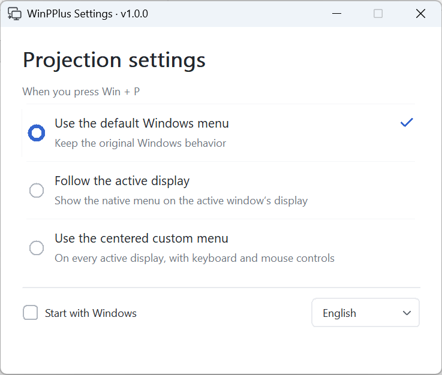
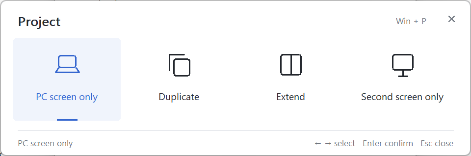

# WinPPlus

[简体中文](README.zh-CN.md) · [Download](https://github.com/zackxjxc/winpplus/releases/latest)

Win+P enhancements for multiple displays:

- **Native menu:** show the Windows projection menu on the active window's display.
- **Custom menu:** show a synchronized, centered menu on every active display.

## The Core Problem This Tool Solves

Using two monitors in Extend mode, with your primary monitor in use by another device? Want Windows on the secondary screen only, but can’t see the `Win + P` menu? WinPPlus can show a projection menu on every screen or force the system menu to appear on your current screen, so you no longer have to switch blindly.

## Usage

Download and run **WinPPlus.exe**, choose a mode, then press **Win+P**. No installation required.

Windows x64. The custom menu targets Windows 10 1607 and later; native-menu routing is currently validated on Windows 11.

[Developer notes](docs/architecture.md) · [MIT License](LICENSE) · [Third-party notices](THIRD_PARTY_NOTICES.md)
