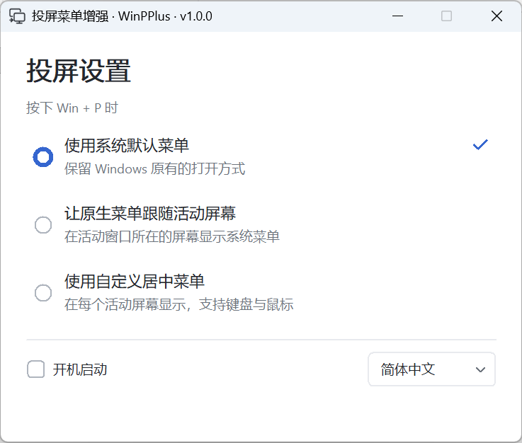
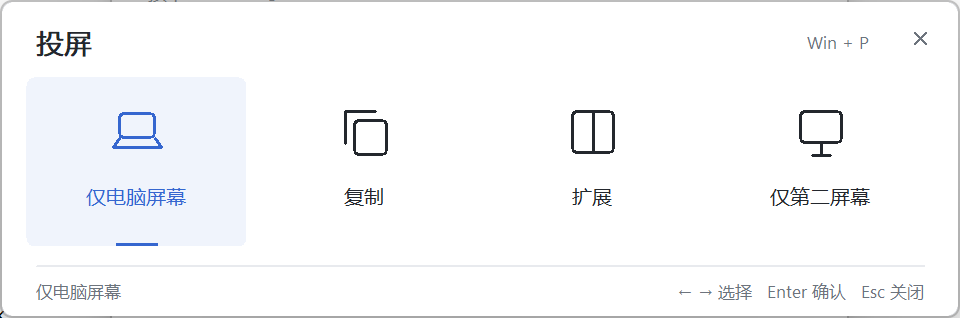

# 投屏菜单增强 · WinPPlus

[English](README.md) · [下载](https://github.com/zackxjxc/winpplus/releases/latest)

让 Win+P 菜单更适合多屏使用：

- **原生菜单跟随活动屏幕：** 在当前活动窗口所在的屏幕显示系统投屏菜单。
- **每屏同步的自定义菜单：** 在每个活动屏幕中央同时显示菜单，选择同步。

## 使用

下载并运行 **WinPPlus.exe**，选择一种模式，再按 **Win+P** 即可。无需安装。

面向 Windows x64。自定义菜单的兼容目标为 Windows 10 1607 及以上；原生菜单优化目前在 Windows 11 上验证。

[开发说明](docs/architecture.md) · [MIT 许可证](LICENSE) · [第三方许可](THIRD_PARTY_NOTICES.md)
